<p align="center">
  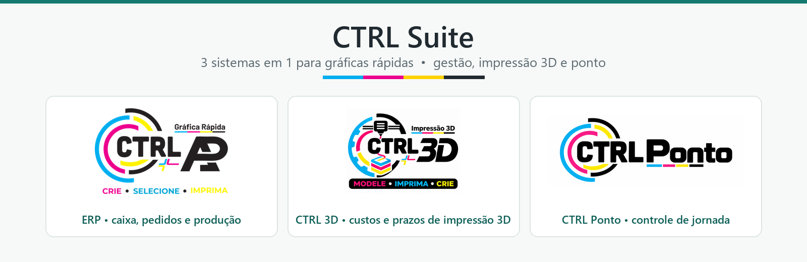
</p>

<p align="center">
  
  
  
  
  
</p>

<p align="center">
  <b>Gestão completa de uma gráfica rápida em três sistemas com o mesmo visual:</b><br>
  caixa, pedidos e produção • orçamentos de impressão 3D • controle de jornada da equipe.
</p>

---

## Sumário

- [Os três sistemas](#os-três-sistemas)
- [CTRL ERP — gestão da gráfica](#ctrl-erp--gestão-da-gráfica)
- [CTRL 3D — custos e prazos de impressão 3D](#ctrl-3d--custos-e-prazos-de-impressão-3d)
- [CTRL Ponto — controle de jornada](#ctrl-ponto--controle-de-jornada)
- [Design system compartilhado](#design-system-compartilhado)
- [Tecnologias e arquitetura](#tecnologias-e-arquitetura)
- [Como rodar](#como-rodar)
- [Privacidade e segurança](#privacidade-e-segurança)

---

## Os três sistemas

| | Sistema | Para quê | Tecnologia |
|:-:|---|---|---|
| 🧾 | **[CTRL ERP](erp/)** | Caixa, pedidos e produção, orçamentos, clientes, devedores, compras e relatórios. Desktop + celular. | .NET 10 (WPF), servidor próprio, PWA, SQLite |
| 🖨️ | **[CTRL 3D](ctrl-3d/)** | Lê o arquivo do fatiador e calcula custo, preço, prazo e quantas peças cabem na mesa da impressora. | Python, pywebview (WebView2), SQLite |
| ⏱️ | **[CTRL Ponto](ctrl-ponto/)** | Registro de jornada, saldo de horas, folha mensal A4 em PDF e histórico de alterações. | Python, pywebview (WebView2), JSON |

Os três foram desenhados para conversar entre si: o **mesmo design system**, os mesmos componentes e o mesmo jeito de usar.
Quem aprende um, já sabe usar os outros.

---

## CTRL ERP — gestão da gráfica

Sistema principal da loja. Um **servidor no Windows** guarda os dados e atende o **desktop** e o **celular** (PWA)
pela rede local ou pelo Tailscale, com HTTPS e aparelhos pareados.

- **Caixa:** abertura e fechamento com Confere/Falta/Sobra, sangria, devolução, recebimentos por forma de pagamento.
- **Pedidos e produção:** etapas, sinal, prazo em dias úteis com feriados de SP, ficha do pedido em PDF com QR code.
- **Clientes e devedores:** cadastro sem telefone duplicado, mesclagem, cobrança por WhatsApp com modelos de mensagem.
- **Produtos, compras e fornecedores:** custo, preço sugerido e lista de compras.
- **Relatórios:** financeiro por período e lucro por pedido conferido.
- **Celular (PWA):** início, pedidos, produção, calculadora e lançamento de venda.
- **Acompanhamento:** página pública para o cliente ver o andamento do pedido.
- **Qualidade:** suítes de testes de integridade, API, hotfix, desempenho e operações assíncronas.

> As telas do ERP não aparecem aqui porque o banco de demonstração dele ainda não existe e as telas reais mostram clientes.
> Detalhes em [erp/README.md](erp/README.md).

---

## CTRL 3D — custos e prazos de impressão 3D

Feito para a **Anycubic Kobra X** (4 cores). Arraste o arquivo do fatiador e o orçamento sai em quatro etapas.

<table>
<tr>
<td width="50%">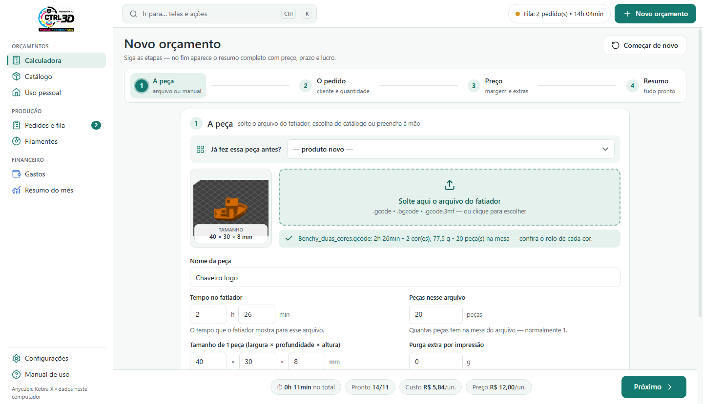<br><sub><b>1. A peça</b> — solte o <code>.gcode</code>, <code>.bgcode</code> ou <code>.gcode.3mf</code>: tempo, gramas por cor, tamanho e foto saem do arquivo.</sub></td>
<td width="50%">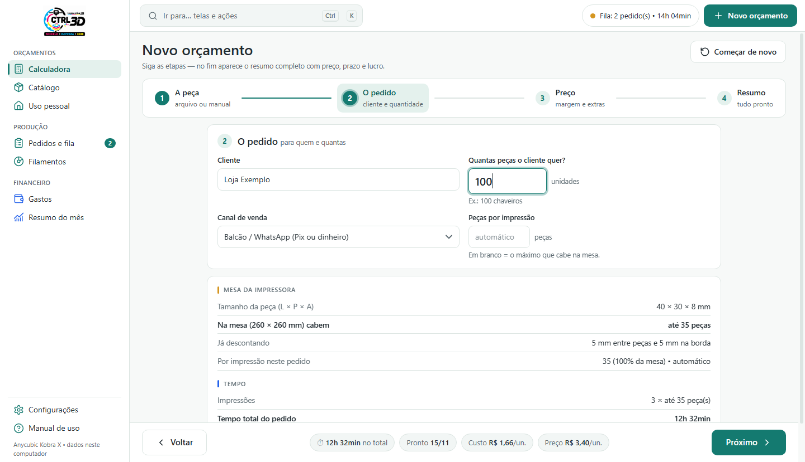<br><sub><b>2. O pedido</b> — quantas peças cabem na mesa (com folga entre peças e na borda) e o tempo total.</sub></td>
</tr>
<tr>
<td>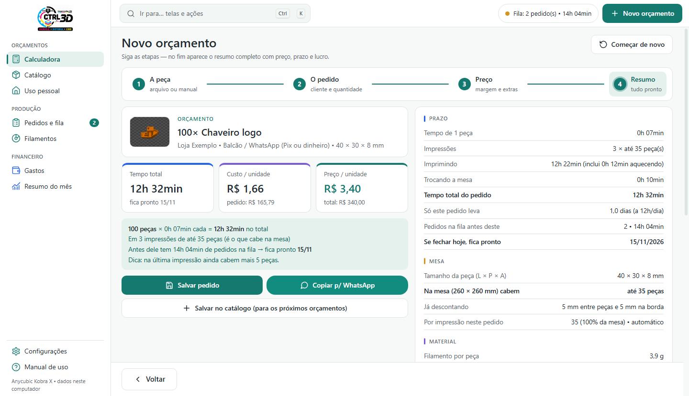<br><sub><b>4. Resumo</b> — tempo, prazo considerando a fila, custo, preço e lucro; copiar para o WhatsApp.</sub></td>
<td>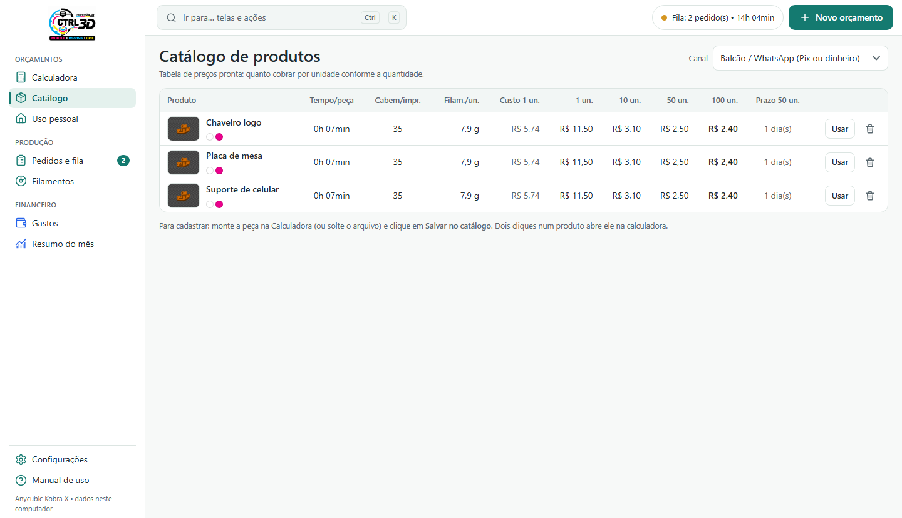<br><sub><b>Catálogo</b> — tabela de preços por quantidade e canal de venda (balcão, Shopee, Mercado Livre).</sub></td>
</tr>
<tr>
<td>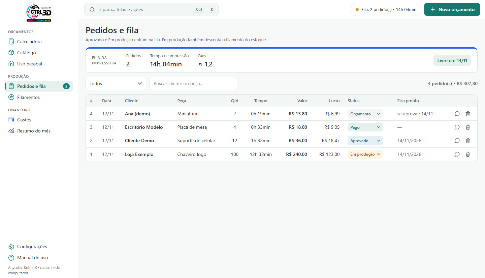<br><sub><b>Pedidos e fila</b> — status com um clique; "Em produção" desconta o filamento do estoque.</sub></td>
<td>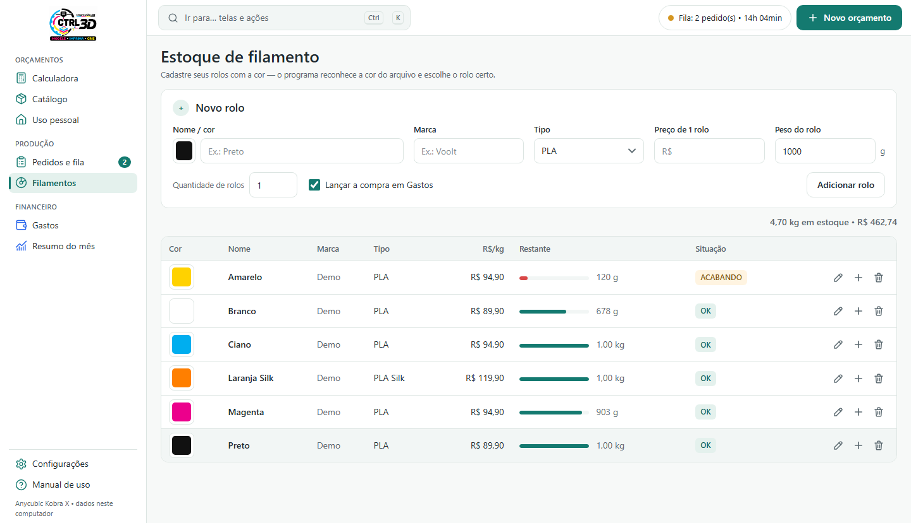<br><sub><b>Filamentos</b> — R$/kg, quanto sobra e aviso de rolo acabando; a cor do rolo casa com a do arquivo.</sub></td>
</tr>
<tr>
<td>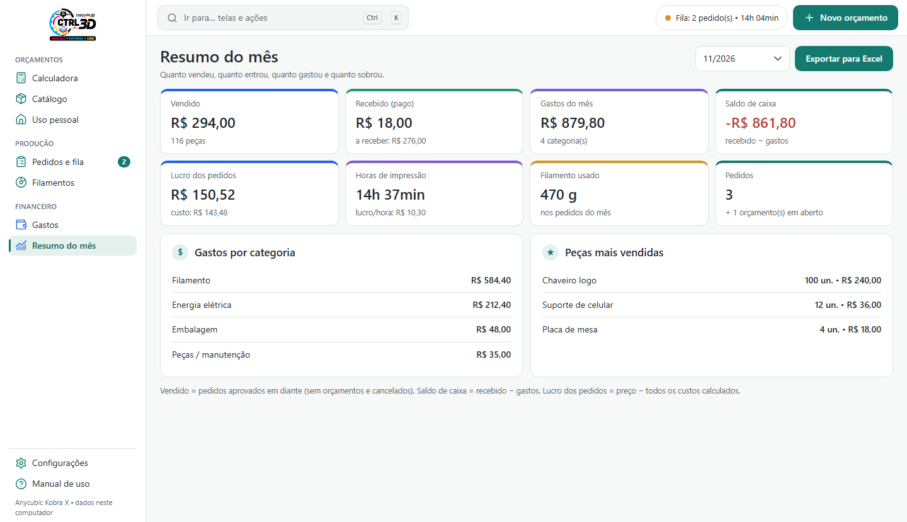<br><sub><b>Resumo do mês</b> — vendido, recebido, gastos, lucro e exportação para Excel.</sub></td>
<td>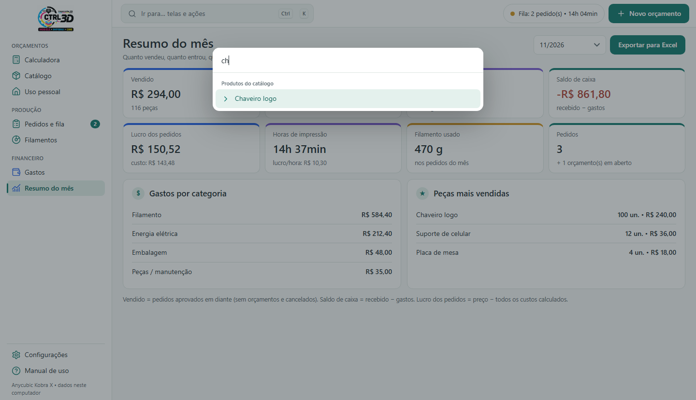<br><sub><b>Ctrl+K</b> — paleta de comandos para ir a qualquer tela, ação ou produto.</sub></td>
</tr>
</table>

**Destaques técnicos**
- Leitor de arquivos de fatiador: G-code de texto (Anycubic, Orca, Prusa, Cura), `.gcode.3mf` e **`.bgcode` binário**,
  com descompactação **Heatshrink + MeatPack** implementada do zero.
- Tamanho da peça pelo contorno gravado pelo fatiador ou, se não houver, **medido pelo caminho do bico**.
- Custo completo: filamento por cor, energia, desgaste da máquina, reserva para falhas, mão de obra, embalagem, taxas do canal e imposto.
- Modo **Uso pessoal**: só o que sai do bolso, com baixa no estoque.

---

## CTRL Ponto — controle de jornada

Reescrito do zero lendo o mesmo arquivo de dados da versão anterior, com os totais conferidos contra a folha antiga.

<table>
<tr>
<td width="50%">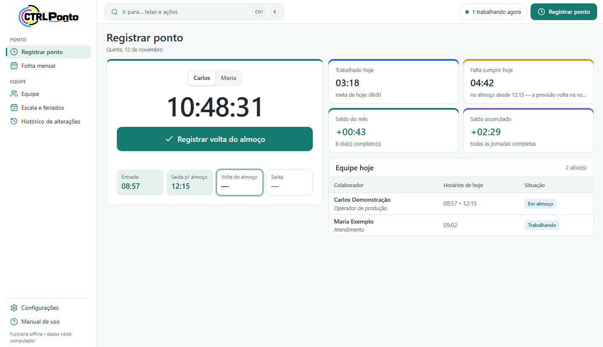<br><sub><b>Registrar ponto</b> — botão do próximo registro (F2), linha do dia, quanto falta e a que horas cumpre a meta.</sub></td>
<td width="50%">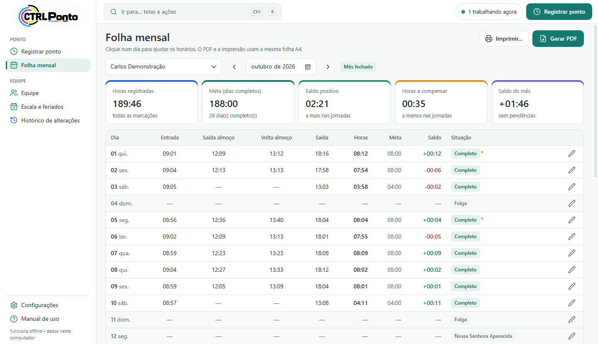<br><sub><b>Folha mensal</b> — saldo positivo, horas a compensar e situação de cada dia.</sub></td>
</tr>
<tr>
<td>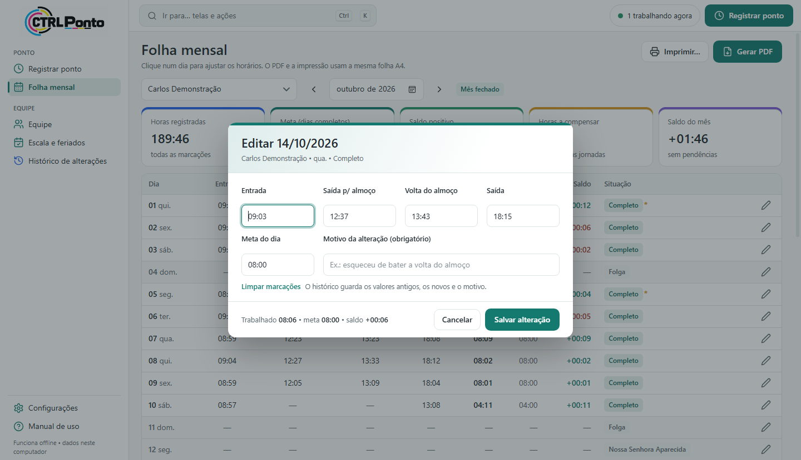<br><sub><b>Editar dia</b> — saldo recalculado ao digitar; motivo obrigatório, antes e depois vão para o histórico.</sub></td>
<td>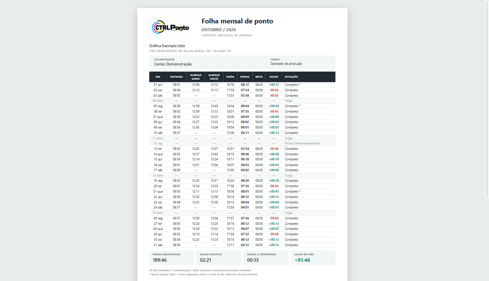<br><sub><b>Folha A4</b> — a mesma composição no PDF e na impressão, em uma página, com linhas de assinatura.</sub></td>
</tr>
<tr>
<td>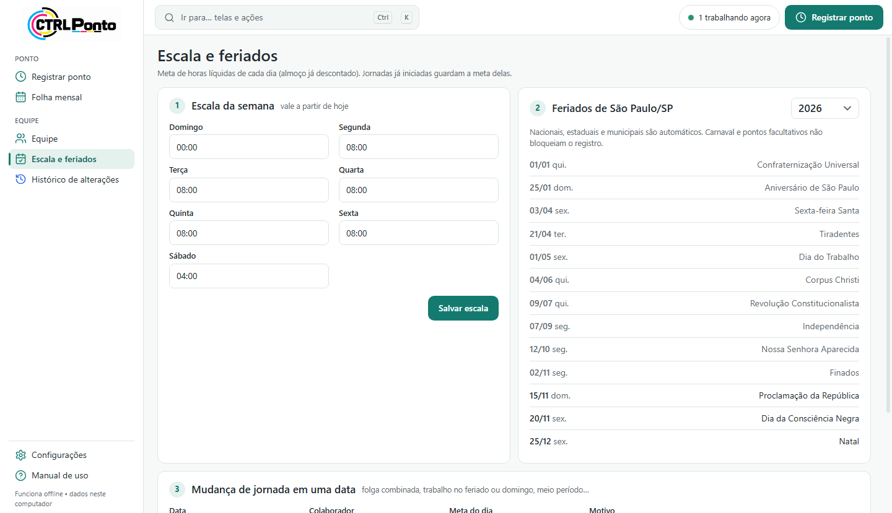<br><sub><b>Escala e feriados</b> — metas por dia da semana, feriados de São Paulo/SP automáticos e mudanças de jornada.</sub></td>
<td>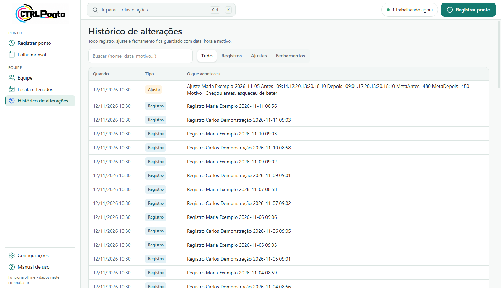<br><sub><b>Histórico</b> — todo registro, ajuste e fechamento pesquisável.</sub></td>
</tr>
</table>

**Destaques técnicos**
- Ícone na bandeja do Windows, uma instância só, início com o Windows e fechamento automático do mês em PDF.
- PDF gerado pelo próprio motor do navegador (`Page.printToPDF` do WebView2): o mesmo HTML vira PDF e impressão.
- Feriados calculados (inclui Páscoa, Sexta-feira Santa e Corpus Christi).
- Campos desconhecidos do arquivo de dados são preservados ao salvar: compatível com a versão anterior.

---

## Design system compartilhado

O visual nasceu no ERP (WPF) e foi levado para os apps web num CSS único, [`erp.css`](ctrl-3d/ui/erp.css):
mesmas cores, tema claro e escuro automático, menu lateral, barra superior com Ctrl+K, cartões de indicador com faixa colorida,
tabelas, etiquetas de status, diálogos e toasts. Tokens e regras em [docs/design-system.md](docs/design-system.md).

---

## Tecnologias e arquitetura

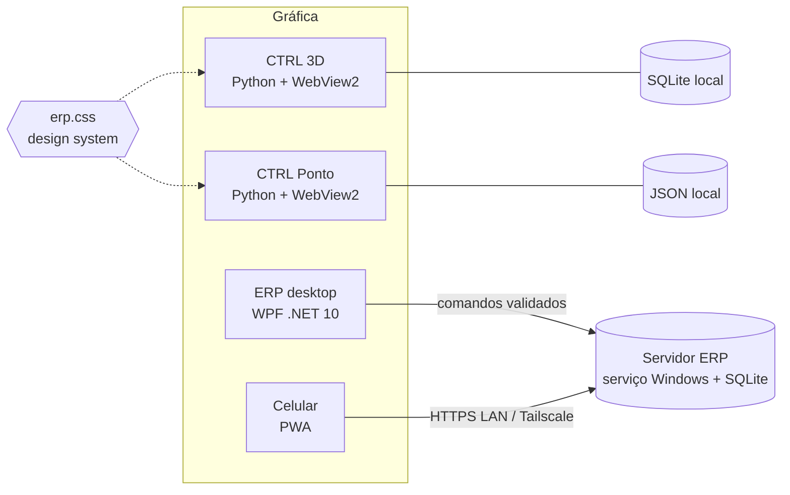

| Camada | ERP | CTRL 3D e CTRL Ponto |
|---|---|---|
| Interface | WPF (XAML) + PWA (HTML/JS) | HTML/CSS/JS em janela nativa (pywebview + WebView2) |
| Lógica | C# (`Core/`) | Python (`core.py`) |
| Dados | SQLite no servidor | SQLite / JSON locais, com backups |
| Distribuição | Pacote com atualizador | PyInstaller (`gerar_exe.bat`) |

---

## Como rodar

```bash
# ERP (Windows, .NET 10 SDK)
cd erp
dotnet run --project IntegrityTests/IntegrityTests.csproj   # testes
dotnet run --project Wpf/GraficaCaixa.Wpf.csproj            # desktop

# CTRL 3D e CTRL Ponto (Windows, Python 3.12)
pip install pywebview pillow openpyxl pystray pyinstaller
cd ctrl-3d    && python app.py
cd ctrl-ponto && python app.py
```

Para gerar o `.exe` de cada app: `gerar_exe.bat` dentro da pasta dele.

---

## Estrutura

```
ctrl-suite/
├── erp/          ERP (WPF, servidor, PWA, testes)
├── ctrl-3d/      Custos e prazos de impressão 3D
├── ctrl-ponto/   Controle de jornada
└── docs/         Capturas de tela, capa e design system
```

---

## Privacidade e segurança

- Nenhum banco de dados, backup, PDF gerado, certificado, chave ou configuração de servidor está no repositório
  (veja o [`.gitignore`](.gitignore)).
- Todas as capturas usam **dados de demonstração** (pessoas, clientes e valores fictícios).
- Nos testes do ERP, telefones, nomes de clientes e endereços de rede foram trocados por fictícios; os testes continuam passando.
- O carimbo real dos recibos foi substituído por uma imagem de exemplo.

---

<p align="center"><sub>Feito para o dia a dia de uma gráfica rápida em São Paulo. Todos os direitos reservados.</sub></p>
